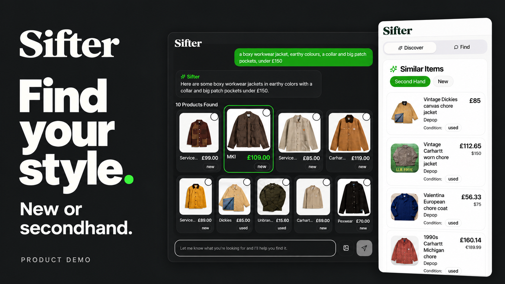

# Sifter

**Find clothing by describing what you want—or starting with something you like.**

Sifter is an AI shopping assistant that searches for visually and semantically similar clothing across new and secondhand listings. It combines a Chrome extension for shopping on retailer websites with a conversational web app.

I built Sifter as a solo project, taking it from product-page extraction and catalogue ingestion through model adaptation, search, user interfaces, and deployment. The original development history spans October 2025–January 2026.

**[Watch the one-minute demo →](https://youtu.be/JD3vFuBSMLw)**

> Archived source snapshot, published separately from the original development repository. The video was recorded locally in October 2026 using the original application, a small sample catalogue, and restoration fixes. The original hosted services have been retired.

## The product

- **Search in your own words.** Describe a silhouette, material, style, or budget—for example, “a boxy workwear jacket, earthy colours, a collar and big patch pockets, under £150.”
- **Explore from an item.** Select a result and use **More like this** to retrieve alternatives using that product as the reference. The web app also supports photo input.
- **Find alternatives while shopping.** The extension extracts the product from the current retailer page and displays similar new or secondhand items. Its **Find** tab supports requests grounded in that item.

The video shows natural-language search, More like this, and the extension’s secondhand and new results.

## What I built

| Component | Implementation |
| --- | --- |
| Web app and Chrome extension | React and TypeScript interfaces sharing API contracts and extraction logic |
| Product extraction | Structured page data and DOM fallbacks, with handling for changing product pages |
| Catalogue pipeline | Retail and resale ingestion, attribute normalisation, product/offer resolution, and queued enrichment |
| Search API | Fastify, PostgreSQL with pgvector, and an LLM orchestrator that turns requests into searches and filters |
| Embedding services | Gemini semantic embeddings and a LoRA-adapted SigLIP image–text model |
| Background processing and deployment | BullMQ/Redis workers, containerised embedding services, and separate frontend/API/model deployments |

## How retrieval works

Each catalogue product has two representations: a **768-dimensional semantic embedding** of its description and a **1,152-dimensional visual embedding** of its image.

The orchestrator interprets the request, separates descriptive intent from explicit constraints such as price and condition, and chooses whether to start a fresh search or use an existing product as context. SigLIP can embed both images and text, allowing a written description to search product photographs as well as catalogue text.

The dual-embedding search takes a nearest-neighbour shortlist from each embedding space, combines the candidates, and calculates a weighted similarity score. More expensive offer filters are applied to that smaller candidate set. Item-based searches use the reference product’s stored embeddings; modified-item requests can blend its image vector with a text-derived visual vector.

For the visual model, I fine-tuned `google/siglip-so400m-patch14-384` with LoRA. The saved adapter uses rank 16 on the attention query/value projections. The repository includes the serving implementation, adapter configuration, and product-caption preparation code. The demo shows the combined retrieval system; it is not a benchmark of the fine-tune’s improvement over the base model.

## Explore the implementation

| Area | Starting point |
| --- | --- |
| Retrieval and candidate scoring | [Search tools](apps/backend/src/orchestrator/search-tools.ts) |
| Conversation and search intent | [OpenAI orchestrator](apps/backend/src/orchestrator/stylist-openai.ts) |
| Product-page extraction | [Shared extraction package](packages/extraction/src/index.ts) |
| Visual model serving | [SigLIP service](apps/embed-services/image-service/main.py) and [LoRA configuration](apps/embed-services/image-service/lora_siglip_model/adapter_config.json) |
| Semantic model serving | [Text embedding service](apps/embed-services/text-service/main.py) |
| Caption preparation | [Product caption cleaner](apps/random_python/product_caption_cleaner.py) |
| User interfaces | [Web app](apps/web/src/pages/WebApp.tsx) and [extension](apps/extension/src/pages/Extension.tsx) |

## About the demo

The local restoration uses a bounded outerwear catalogue with real source photographs and historical listing information. Results are retrieved through the application’s backend and embedding services. Prices and availability are snapshots, not live shopping guarantees.

The October 2026 work added local infrastructure and sample-data tooling, corrected SigLIP text padding, and fixed the More like this context handling and reference-item exclusion. The original ranking weights and similarity thresholds were retained.

Retrieval remains approximate: colour is a soft signal, and some results may not match every requested attribute. The fusion weights and thresholds were manually tuned; no measured fine-tuning uplift is claimed here.

For build instructions and service requirements, see the [development guide](docs/DEVELOPMENT.md). This source snapshot excludes credentials, scraper tooling, catalogue data, and model weights. See [publication scope and changes](docs/SOURCE_SNAPSHOT.md) and the [verification report](docs/VERIFICATION.md). A clone alone does not reproduce the recorded demo.

## What came next

I moved on from Sifter to build quantitative trading systems for prediction markets. After working independently, I teamed up with a friend who had worked as a market-making trader.

We are now building an AI quant researcher that helps trading teams test ideas, verify results, and retain what they learn. Sifter is an earlier example of my work building a complete application around models, retrieval, and real-world data.
